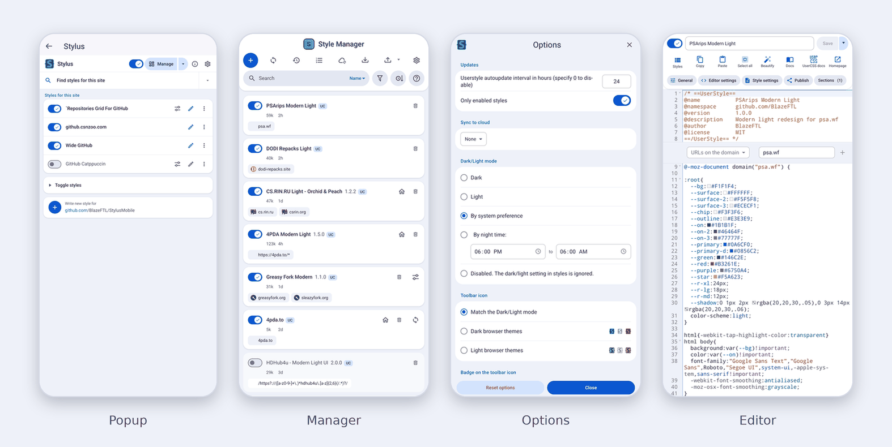
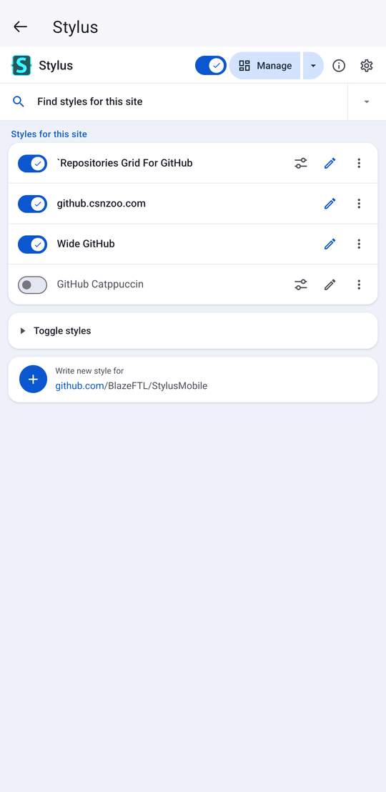
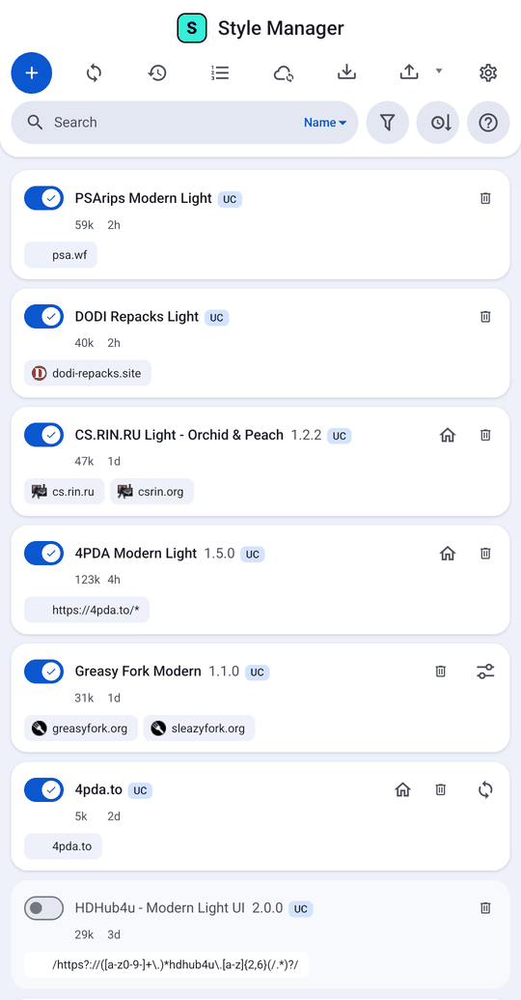
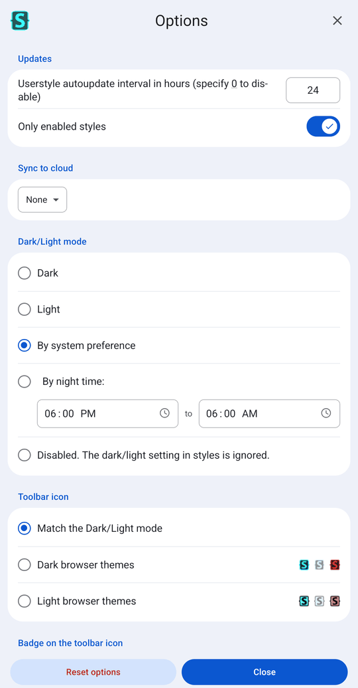
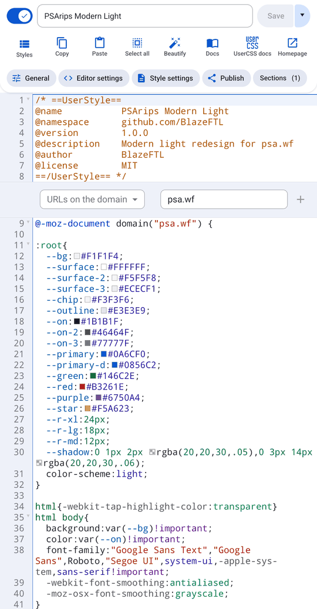
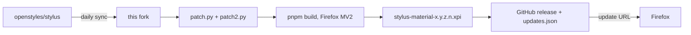

<div align="center">


# Stylus Material

**Stylus, rebuilt for the phone in your hand.**<br>
The [Stylus](https://github.com/openstyles/stylus) userstyles manager with a mobile-first redesign for Firefox on Android, plus editor tools Stylus does not have: search and replace, copy and paste buttons, and Gboard fixes.

[](https://github.com/BlazeFTL/StylusMaterial/actions/workflows/BuildFork.yml)
[](https://github.com/BlazeFTL/StylusMaterial/actions/workflows/SyncUpstream.yml)
[](https://github.com/BlazeFTL/StylusMaterial/releases/latest)
[](./LICENSE)

[What is this?](#what-is-this) &nbsp;·&nbsp; [What it adds](#what-it-adds) &nbsp;·&nbsp; [Install](#install) &nbsp;·&nbsp; [FAQ](#faq) &nbsp;·&nbsp; [How it works](#how-it-works) &nbsp;·&nbsp; [Build it yourself](#build-it-yourself)

<br>



</div>

<br>

## What is this?

[Stylus](https://github.com/openstyles/stylus) is a browser add-on that restyles websites with custom CSS (called userstyles): dark modes, cleaner layouts, hidden clutter. It runs on Firefox for Android, but its screens were made for a desktop. On a phone you get tiny buttons, a table-style list and an editor that is hard to use with a thumb.

**Stylus Material is the same Stylus with an interface made for phones.** Your styles, UserCSS, sync, backups and auto-updates work as before. What changes is everything you see and tap, plus a few editor tools that make writing CSS on a phone practical.

## At a glance

| | Stock Stylus on a phone | Stylus Material |
|---|---|---|
| Look | Brown and peach gradients, desktop spacing | Flat, light Material design with one blue accent. Dark mode follows the Stylus Dark/Light option. |
| Style list | Table with small controls | Cards with large icon buttons |
| Buttons | Mostly small text | Icons you can recognize, with captions in the editor |
| Editor toolbar | Wide desktop toolbar | One compact toolbar with captioned icons |
| Find and replace | No toolbar button, relies on keyboard shortcuts | Search and replace bar in the top panel |
| Copy and paste | No toolbar buttons | Copy, Paste and Select all buttons |
| Gboard | Line numbers get copied, extra blank lines on Copy and Cut, display glitches after Backspace | Fixed |
| Updating and importing | Little feedback | Progress bars with a percentage and a counter |
| Staying current | Wait for the next Stylus release | Upstream Stylus is merged in daily and a new build is published |

## What it adds

### Search and replace in the editor

Tap **Search** in the editor toolbar. A bar opens in the top panel.

- Highlights every match and shows a live counter such as `3/12`, with previous and next buttons.
- Searches every section of the style, not only the one you are in.
- Case-insensitive until you type an uppercase letter.
- Tap the swap icon to show the replace field. **Replace** changes one match, **All** changes every match and confirms with `N replaced`.
- If you select a word before opening the bar, it is filled in for you.
- Long-press a highlighted match to select the whole match.
- **Enter** goes to the next match, **Shift+Enter** to the previous one, **Esc** closes the bar. The on-screen keyboard stays open while you tap the bar's buttons.

### Copy, Paste and Select all buttons

Three toolbar buttons that work on the editor you used last. The keyboard stays open when you tap them, and a short message confirms what happened.

- **Copy** copies the selection. With nothing selected, it copies the whole style.
- **Paste** replaces the whole editor content with your clipboard. To insert at the cursor, long-press the editor and paste normally.
- **Select all** selects everything in the editor.

### Gboard and Android text fixes

CodeMirror 5, the editor inside Stylus, has several problems with Gboard and Android text selection. Stylus Material fixes them:

- Line numbers are no longer part of your selection, Copy or Cut.
- Backspace or Clear on a selection no longer leaves the editor display out of sync.
- Gboard **Copy** and **Cut** from the text-editing panel no longer add blank lines between code lines.
- Copy from the Android selection menu reaches the clipboard on builds that would otherwise drop it.

### Progress you can see

- **Update check:** a bar with a live percentage and a counter such as `Checking 12 / 80`.
- **Import:** the same bar through `Analyzing`, `Importing n / total` and `Done`, so a large backup no longer looks frozen.

### Always the mobile layout

- The manager always shows the card list. An imported backup can no longer switch you back to the table view or a wide layout.
- The editor always uses the compact layout.

### Always up to date

The fork follows Stylus. New upstream commits are merged every day and a fresh build is released. Firefox updates the add-on by itself. See [Updates](#updates).

## The redesign, screen by screen

<details open>
<summary><b>Popup</b></summary>

<br>

- Top bar with the Stylus logo, the master on/off switch, a **Manage** pill with its own dropdown, and info and settings icons.
- **Find styles for this site** row with a visible search progress, then results below it.
- **Toggle styles** card and a **Write new style for** card showing the current site.
- Per-style icons that read at a glance: configure, edit, menu.
- Delete confirmation matches every other dialog: red title, filled red **Delete** button.

</details>

<details open>
<summary><b>Manager</b></summary>

<br>

- Centered title and one icon toolbar: add, check for updates, history, injection order, cloud sync, import, export, settings.
- One search row with a sort icon. Filters, and links and backup, open as popovers when tapped.
- Per-card icons: configure, homepage, update, delete.

</details>

<details open>
<summary><b>Editor</b></summary>

<br>

- First row: enable switch, style name and **Save**.
- Captioned icon toolbar: **Styles, Beautify, RegExp, Select all, Search, Copy, Paste, Import, Export, Docs, UserCSS docs, Homepage**. It fits in one row when the screen is wide enough and otherwise wraps into balanced rows.
- The Publish and Sections panels open under their own buttons and stay inside the screen.
- The `@-moz-document` section widget lines up with the code gutter.
- The sticky header gets a shadow while you scroll.

</details>

<details open>
<summary><b>Options and dialogs</b></summary>

<br>

- Gboard-style settings: rounded cards on a tinted background, icon on the left, centered title, close on the right.
- Uniform 56 px rows with consistent dividers and real toggle switches, including the Dark/Light radio list.
- Night-time schedule shown as `06:00 PM  to  06:00 AM` with large time fields.
- Dialog titles are never clipped. The injection order dialog uses the same colors.

</details>

<details open>
<summary><b>Icons</b></summary>

<br>

57 [Material Design icons](https://fonts.google.com/icons) replace the stock icons. They are rebuilt into the icon font on every build, and the existing icon IDs are kept, so nothing else in Stylus notices.

</details>

<details>
<summary><b>More screenshots</b></summary>

<br>

<table>
  <tr>
    <td align="center"><br><sub>Popup</sub></td>
    <td align="center"><br><sub>Manager</sub></td>
    <td align="center"><br><sub>Options</sub></td>
    <td align="center"><br><sub>Editor</sub></td>
  </tr>
</table>

</details>

## Install

1. Open the [latest release](https://github.com/BlazeFTL/StylusMaterial/releases/latest) in Firefox on Android.
2. Tap `stylus-material-<version>.xpi`, then **Add**.

Builds are unsigned. On **Firefox Nightly**, set `xpinstall.signatures.required` to `false` in `about:config` first.

### Updates

Every build contains an update address that points to `updates.json` in the latest release, together with a SHA-256 hash of the `.xpi`. Firefox checks it on its normal add-on update schedule. Each build also raises the minor version and adds a build number as a fourth part (`major.minor.patch.build`), so a new build is always newer than the last one.

## FAQ

**Is this a separate app?**
No. It is a Firefox add-on, the same kind of file as Stylus.

**Will my styles still work?**
Yes. The Stylus engine is untouched: UserCSS, the built-in editor and linters, cloud sync, backups, auto-update and the style gallery search all work as before.

**Can I keep the official Stylus installed?**
By default, no. The add-on ID is the same as the official Stylus, so Firefox treats this build as the same add-on. If you build your own copy with a different ID (see [Run your own fork](#run-your-own-fork)), it installs next to Stylus as a separate add-on. Then move your styles over with **Export** and **Import** in the manager. Export a backup before you switch either way.

**What does it change in permissions?**
It adds `clipboardRead` and `clipboardWrite`, which the Copy and Paste buttons need. Nothing else is added.

**Does it work on desktop or in Chrome?**
It is built and designed for Firefox on Android. The releases contain a Firefox build only.

**Where do I report a bug?**
Problems with the redesign and the new tools belong in this repository's issues. Bugs in the Stylus engine itself belong [upstream](https://github.com/openstyles/stylus/issues).

## How it works

This fork has no hand-edited UI code. Two Python scripts, [`patch.py`](./patch.py) and [`patch2.py`](./patch2.py), rewrite a clean copy of Stylus into Stylus Material every time it is built. That is why merging new Stylus changes every day does not cause conflicts.



| Script | Does |
|---|---|
| [`patch.py`](./patch.py) | Writes the Material stylesheet and swaps in the new icon set. Edits the HTML and JavaScript through anchored replacements. Adds the Copy, Paste and Select all buttons, the update and import progress bars and the panel positioning. Forces the mobile behavior (card list, compact editor). Adds the clipboard permissions and sets the version, name, add-on ID and update address. Runs `patch2.py` when done. |
| [`patch2.py`](./patch2.py) | Adds the search and replace bar and the toolbar fit that picks one row or several. Applies the Gboard fixes: line numbers drawn by CSS, selection and Backspace healing, and a build-time webpack patch (`tools/wp-patch-cm-dom.js`) that retags CodeMirror's line elements so Gboard Copy and Cut produce exactly one newline per line. |

Both scripts are safe to run again: every edit is skipped when it is already applied. In CI they run with `--strict`. If upstream moves a spot the patch depends on, the build fails instead of shipping a half-patched interface.

To run only the second patch on an already patched checkout: `python patch2.py`.

### Workflows

| Workflow | Trigger | Does |
|---|---|---|
| [`SyncUpstream.yml`](./.github/workflows/SyncUpstream.yml) | Daily at 03:17 UTC, or manually | Merges `openstyles/stylus` into the fork and pushes. Keeps this README on conflict and leaves the fork's workflows untouched. Starts a build when new upstream commits arrived. |
| [`BuildFork.yml`](./.github/workflows/BuildFork.yml) | Manually, on a push that changes `patch.py`, `patch2.py` or the workflow, or started by the sync | Runs `patch.py` (which runs `patch2.py`), builds the Firefox MV2 package, writes `updates.json`, uploads the `.xpi` and publishes a release. |

If a sync hits a conflict anywhere other than `README.md` or `.github/workflows`, it stops with an error that lists the files so you can resolve them by hand.

## Build it yourself

Requirements: Python 3, Node.js 24 or newer, pnpm.

```bash
git clone https://github.com/BlazeFTL/StylusMaterial
cd StylusMaterial
python patch.py --build
```

This applies the patches, installs dependencies, builds Firefox MV2 and packs `stylus-material-<version>.xpi`. Without `--build` it only patches. Then run `pnpm build-firefox`.

| Flag | Effect |
|---|---|
| `--build` | `pnpm install`, build Firefox MV2, pack the `.xpi` |
| `--no-bump` | Keep the version as it is |
| `--id "{uuid}"` | Set the Gecko add-on ID |
| `--name "Stylus Material"` | Set the extension name |
| `--update-url URL` | Set the Firefox auto-update manifest URL |
| `--build-number N` | Append `N` as the fourth version part |
| `--strict` | Exit with an error if any patch anchor was not found |

## Run your own fork

1. Fork this repository and enable Actions.
2. Optional repository variables under **Settings, Secrets and variables, Actions, Variables**:
   - `ADDON_ID`: your Gecko add-on ID
   - `EXT_NAME`: the extension name
3. Run **build-fork** once from the Actions tab. **sync-upstream** then runs on its own every day.

The built-in `GITHUB_TOKEN` cannot push workflow files. This is why the sync keeps your copies of `.github/workflows` instead of taking upstream's.

## Credits and license

Stylus Material is a fork of [Stylus](https://github.com/openstyles/stylus) by the Stylus Team and is not affiliated with it.

- Released under the [GPLv3](./LICENSE), same as Stylus.
- Copyright &copy; 2017-2025 [Stylus Team](https://github.com/openstyles/stylus/graphs/contributors).
- Copyright &copy; 2005-2014 Jason Barnabe for the remaining parts of the original [Stylish](https://github.com/stylish-userstyles/stylish/).
- Icons are [Material Design icons](https://fonts.google.com/icons), Apache-2.0.
- Fork by [BlazeFTL](https://github.com/BlazeFTL).
