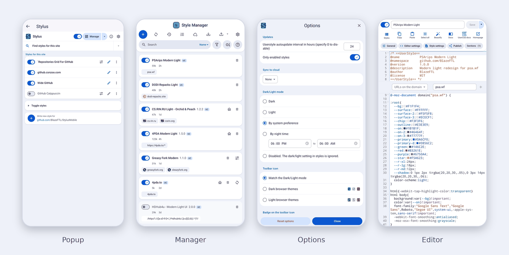
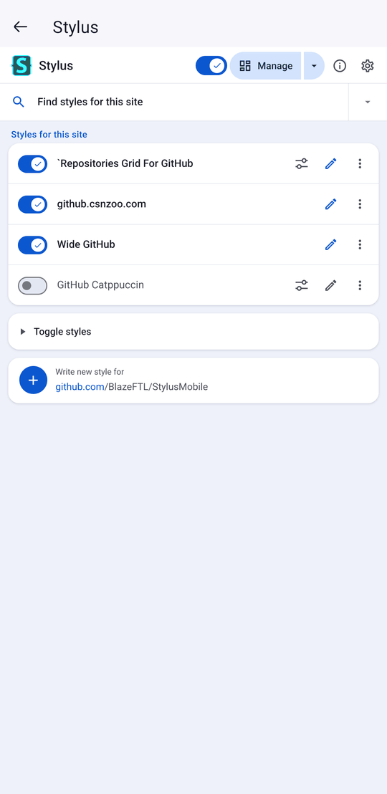
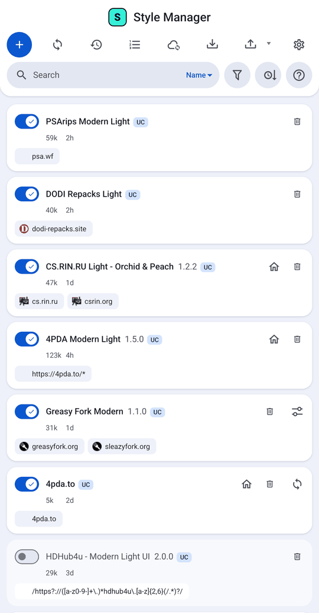
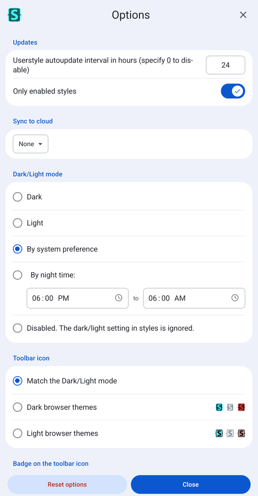
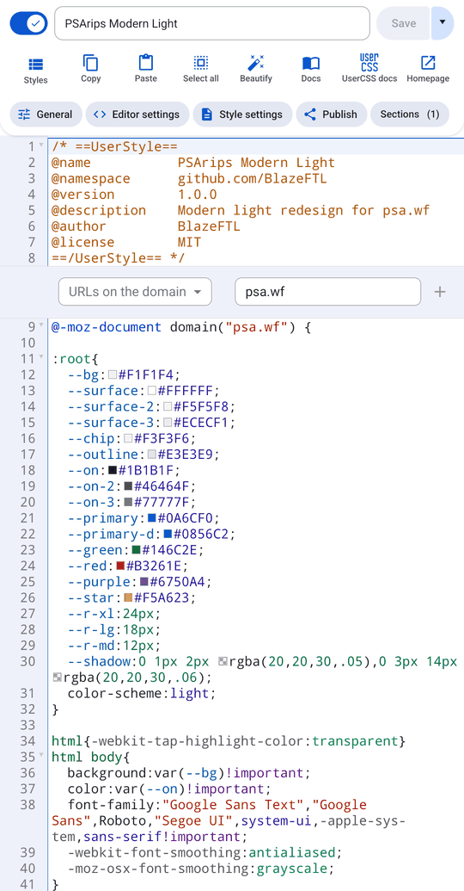
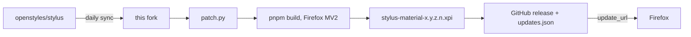

<div align="center">


# Stylus Material

**Stylus, rebuilt for the phone in your hand.**<br>
A flat, light, Material-style mobile redesign of the [Stylus](https://github.com/openstyles/stylus) userstyles manager for Firefox on Android.

[](https://github.com/BlazeFTL/StylusMobile/actions/workflows/BuildFork.yml)
[](https://github.com/BlazeFTL/StylusMobile/actions/workflows/SyncUpstream.yml)
[](https://github.com/BlazeFTL/StylusMobile/releases/latest)
[](./LICENSE)

[Install](#install) &nbsp;·&nbsp; [Features](#features) &nbsp;·&nbsp; [How it works](#how-it-works) &nbsp;·&nbsp; [Build it yourself](#build-it-yourself) &nbsp;·&nbsp; [Run your own fork](#run-your-own-fork)

<br>



</div>

<br>

## Why

Stock Stylus is a desktop UI squeezed onto a phone: brown and peach gradients, tiny hit targets, a table-style manager, and buttons that say nothing about what they do. Stylus Material keeps the engine and replaces everything you touch.

- Flat Material surfaces, one blue accent, no gradients.
- Layouts modeled on Violentmonkey: one compact icon toolbar per page, actions at the top, not buried at the bottom.
- Every icon clearly shows what it does. Editor icons carry captions.
- Settings that look like Gboard: rounded cards on a tinted background, 56 px rows, real toggle switches.
- Light and dark, following the Stylus Dark/Light option.

Everything else is still Stylus: UserCSS, the built-in editor and linters, cloud sync, backups, auto-update, the style gallery search.

## Features

<details open>
<summary><b>Popup</b></summary>

<br>

- Top bar with brand, master on/off switch, a **Manage** pill with its own dropdown, info and settings icons.
- **Find styles for this site** row with a visible search progress, then inline results.
- **Toggle styles** card and a **Write new style for** card with the current site.
- Per-style icons that read at a glance: configure, edit, menu.
- Delete confirmation matches every other dialog: red title, filled red **Delete** button.

</details>

<details open>
<summary><b>Manager</b></summary>

<br>

- Card list only. Imported backups can no longer flip you back to the table view or the wide layout.
- Centered, capitalized title and one icon toolbar: add, check for updates, history, injection order, cloud sync, import, export, settings.
- One search row with a sort icon. Filter and help (links and backup) open as popovers when tapped.
- Per-card icons: configure, homepage, update, delete.
- Delete confirmation with a red primary button.

</details>

<details open>
<summary><b>Editor</b></summary>

<br>

- Compact layout always on: enable switch, name, and Save in the first row.
- Captioned icon toolbar: **Styles, Copy, Paste, Select all, Beautify, Docs, UserCSS docs, Homepage**.
- New **Copy**, **Paste** and **Select all** buttons that work on the active editor.
  - Copy takes the selection, or the whole style when nothing is selected.
  - Paste replaces the editor content with the clipboard.
  - The on-screen keyboard stays open while you tap them, and a toast confirms the result.
- Section widget (`@-moz-document`) lines up with the code gutter.
- Sticky header gains elevation while you scroll.

</details>

<details open>
<summary><b>Options and dialogs</b></summary>

<br>

- Gboard-style settings: icon left, centered title, close right.
- Uniform 56 px rows with consistent dividers, including the Dark/Light radio list.
- Night-time schedule shown as `06:00 PM  to  06:00 AM` with large time fields.
- Toolbar icon choices with their preview icons pushed to the right.
- Dialog titles are never clipped. The injection order dialog uses the same palette.

</details>

<details open>
<summary><b>Icons</b></summary>

<br>

Almost 60 [Material Design icons](https://fonts.google.com/icons) replace the stock glyphs, rebuilt into the icon font on every build. Existing glyph IDs are preserved, so nothing else in Stylus notices.

</details>

<details>
<summary><b>More screenshots</b></summary>

<br>

<table>
  <tr>
    <td align="center"><br><sub>Popup</sub></td>
    <td align="center"><br><sub>Manager</sub></td>
    <td align="center"><br><sub>Options</sub></td>
    <td align="center"><br><sub>Editor</sub></td>
  </tr>
</table>

</details>

## Install

1. Open the [latest release](https://github.com/BlazeFTL/StylusMobile/releases/latest) in Firefox on Android.
2. Tap `stylus-material-<version>.xpi`, then **Add**.

Builds are unsigned. On **Firefox Nightly**, set `xpinstall.signatures.required` to `false` in `about:config` first.

### Updates

Every build embeds an update URL pointing at `updates.json` in the latest release, with a SHA-256 hash of the `.xpi`. Firefox checks it on its normal add-on update schedule. Each build also bumps the minor version and appends a build number as the fourth part (`major.minor.patch.build`), so a new build is always newer than the last.

## How it works

The fork carries no hand-edited UI code. A single script, [`patch.py`](./patch.py), turns a clean Stylus checkout into Stylus Material, and two workflows keep it current.



`patch.py` writes the Material stylesheet, swaps the icon set, edits the HTML and JS entry points through anchored replacements, adds the clipboard bar, and forces the mobile behavior (card list, compact layout). It is safe to re-run: every edit is skipped when already applied. In CI it runs with `--strict`, so if upstream moves an anchor the build fails loudly instead of shipping a half-patched UI.

### Workflows

| Workflow | Trigger | Does |
|---|---|---|
| [`SyncUpstream.yml`](./.github/workflows/SyncUpstream.yml) | Daily 03:17 UTC, manual | Merges `openstyles/stylus` into the fork and pushes. Keeps this README on conflict and leaves the fork's workflows untouched. Triggers a build when new upstream commits landed. |
| [`BuildFork.yml`](./.github/workflows/BuildFork.yml) | Manual, push to `patch.py` or the workflow, triggered by sync | Runs `patch.py`, builds the Firefox MV2 package, writes `updates.json`, uploads the `.xpi`, publishes a release. |

If a sync hits a conflict anywhere other than `README.md` or `.github/workflows`, it stops with an error listing the files so you can resolve them by hand.

## Build it yourself

Requirements: Python 3, Node.js 24+, pnpm.

```bash
git clone https://github.com/BlazeFTL/StylusMobile
cd StylusMobile
python patch.py --build
```

This applies the patch, installs dependencies, builds Firefox MV2 and packs `stylus-material-<version>.xpi`. Without `--build`, it only patches; then run `pnpm build-firefox`.

| Flag | Effect |
|---|---|
| `--build` | `pnpm install`, build Firefox MV2, pack the `.xpi` |
| `--no-bump` | Keep the version as is |
| `--id "{uuid}"` | Set the Gecko add-on ID |
| `--name "Stylus Material"` | Set the extension name |
| `--update-url URL` | Set the Firefox auto-update manifest URL |
| `--build-number N` | Append `N` as the fourth version part |
| `--strict` | Exit with an error if any patch anchor was not found |

## Run your own fork

1. Fork this repository and enable Actions.
2. Optional repository variables under **Settings, Secrets and variables, Actions, Variables**:
   - `ADDON_ID`: your Gecko add-on ID
   - `EXT_NAME`: the extension name
3. Run **build-fork** once from the Actions tab. **sync-upstream** then runs on its own every day.

Workflow files cannot be pushed by the built-in `GITHUB_TOKEN`, which is why the sync keeps your copies of `.github/workflows` instead of taking upstream's.

## Credits and license

Stylus Material is a fork of [Stylus](https://github.com/openstyles/stylus) by the Stylus Team and is not affiliated with it. Bug reports for the redesign belong here; engine bugs belong upstream.

- Released under the [GPLv3](./LICENSE), same as Stylus.
- Copyright &copy; 2017-2025 [Stylus Team](https://github.com/openstyles/stylus/graphs/contributors).
- Copyright &copy; 2005-2014 Jason Barnabe for the remaining parts of the original [Stylish](https://github.com/stylish-userstyles/stylish/).
- Icons are [Material Design icons](https://fonts.google.com/icons), Apache-2.0.
- Fork by [BlazeFTL](https://github.com/BlazeFTL).
